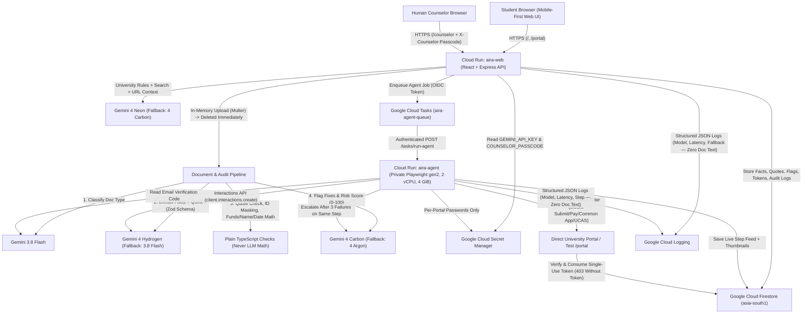

# Aira Application Agent — System Architecture

## End-to-End Architecture Diagram

## Key Architectural Guarantees

1. **Deterministic Truth & Math:** Currency conversion, UK maintenance checks (unpaid CAS tuition + £1,570/mo London or £1,203/mo outside London × 9 months), 28-day holding rules, name matching, quote verification, and Aadhaar/PAN/passport/account masking all run in plain TypeScript (`server/src/checks/`). Any fact whose quote is not found verbatim in the document is marked **"needs review"**.
2. **Human-in-the-Loop Submit Gate (Defense in Depth):**
   - **Layer 1 (Agent Action Filter):** `agent/src/actionFilter.ts` runs before every browser action and blocks Common App, UCAS, payment pages, and clicks on Submit / Declaration / Sign unless a valid counselor approval token exists.
   - **Layer 2 (Portal Server Enforcement):** `/portal`'s Submit endpoint verifies and atomically consumes a single-use token in Firestore (`approval_tokens/{token}`) tied to `(caseId, portalUrl, approvedBy, approvedAt)` and returns **HTTP 403** without one.
   - **No Automatic Tokens:** Clean green cases are pre-approved by rules for fast **batch approval**, but never receive a token until an authenticated counselor clicks **Approve (`A`)** or **Batch Approve**.
3. **Strict Isolation & Privacy:**
   - Uploaded documents stay in `multer` memory buffers only and are cleared immediately after extraction — **no Cloud Storage**.
   - Firestore stores only extracted facts, masked identifiers, verbatim quotes, flags, consent records, tokens, and audit logs.
   - Per-portal passwords are generated randomly and stored **only in Secret Manager**.
   - Cloud Logging records model name, latency, fallback flag, and token counts — **never document contents or secrets**.
